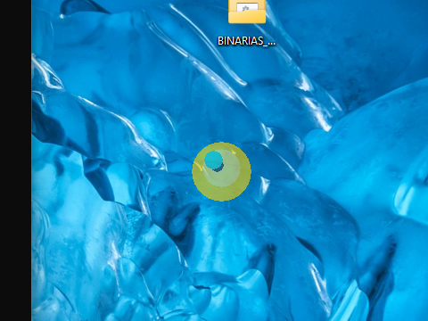
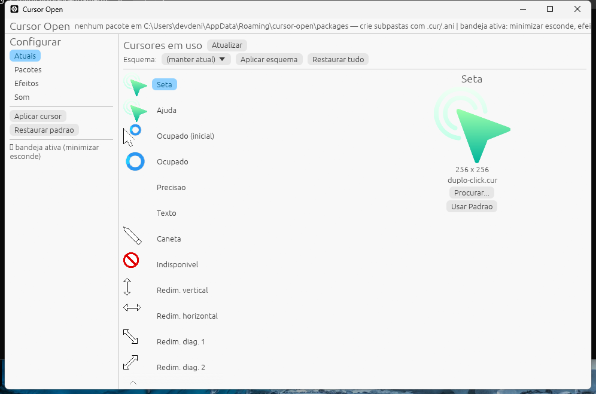
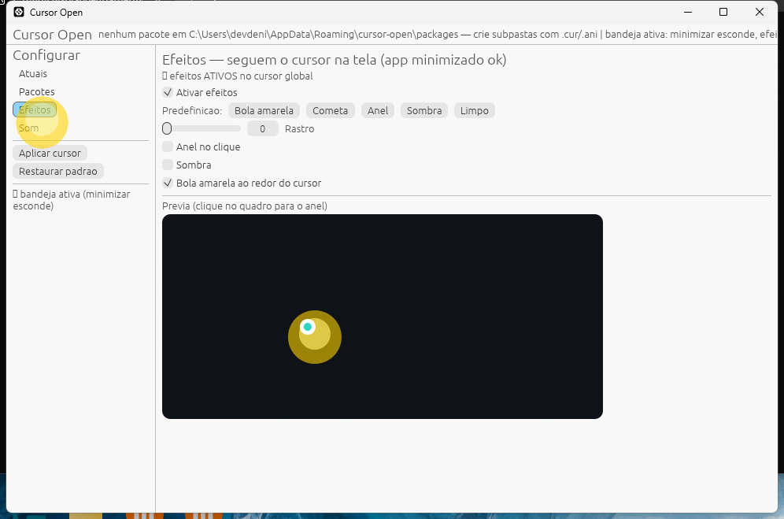
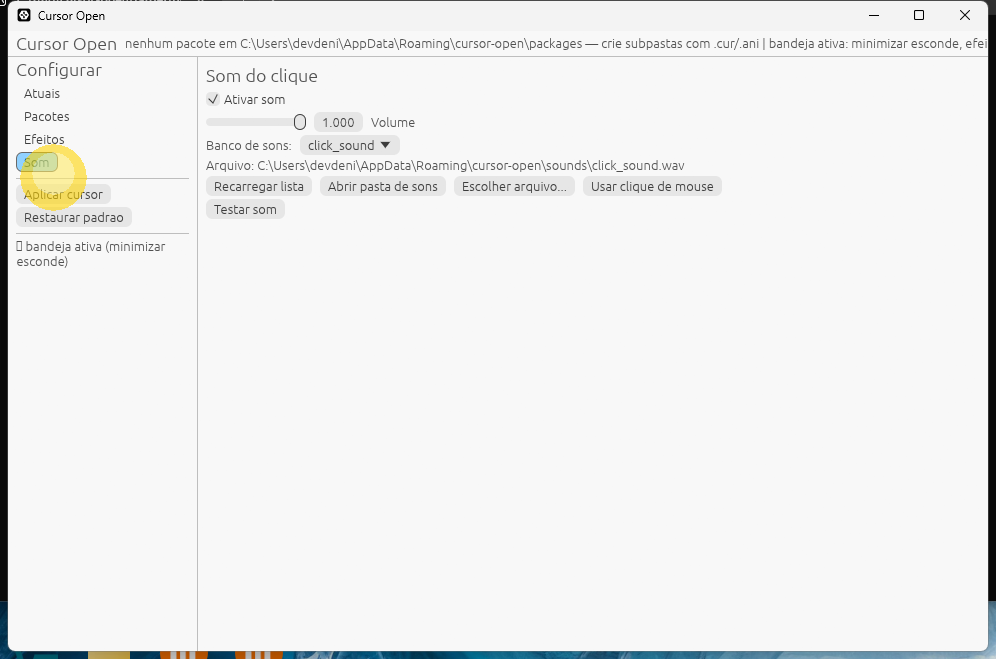

# Cursor Open

Alternativa open source (licença MIT) para trocar **cursor + efeitos + sons** do mouse no Windows. Sem chave, sem trial, sem ThemeEditor, sem banco de dados: tudo em Rust + um JSON local.

*Open-source Windows app (Rust + egui) to customize the mouse cursor, cursor effects (yellow highlight ball, trails, click rings) and mouse click sounds (.wav/.mp3). No key, no trial, MIT licensed.*



## Telas

**Cursores em uso** — os 15 cursores do sistema com imagem de verdade, prévia do novo lado a lado com o atual e troca rápida:



**Efeitos** — bola amarela, rastro, anel no clique e sombra. Seguem o cursor na tela toda; minimizar joga o app para a bandeja e tudo continua rodando:



**Som** — banco próprio + seus `.wav`/`.mp3` (MP3 é convertido para WAV **sem mudar o tom**: taxa e canais originais). O som toca a cada clique esquerdo, em qualquer programa:



## Instalar (Windows)

Opção 1 — pacote pronto (`dist/`):
1. Extraia o ZIP e clique duas vezes em `instalar.ps1` (botão direito > *Executar com PowerShell*).
2. Sem admin: instala em `%LOCALAPPDATA%\CursorOpen`, cria o atalho no Menu Iniciar e abre o app.
3. Extras: `.\instalar.ps1 -Desktop` (atalho na Área de Trabalho), `.\instalar.ps1 -Startup` (abrir com o Windows). `desinstalar.ps1` remove tudo (mantém sua config e seus sons).

Opção 2 — do código-fonte (precisa do [Rust](https://www.rust-lang.org/)):
```powershell
cargo build --release -p cursor-app
.\target\release\cursor-app.exe
```

## Usar

- **Atuais**: clique numa função (Seta, Ajuda, Ocupado…), veja a prévia grande, *Procurar…* um `.cur`/`.ani`, compare Atual × Novo e *Confirmar troca*. *Usar Padrão* restaura a função.
- **Pacotes**: crie subpastas com `.cur`/`.ani` em `%APPDATA%\cursor-open\packages` e aplique o esquema inteiro.
- **Efeitos**: predefinições *Bola amarela*, *Cometa*, *Anel*, *Sombra*, *Limpo*, mais controles separados. O overlay é uma janela layered que segue o cursor; o anel aparece no clique.
- **Som**: o gancho toca o som configurado em todo clique esquerdo (o app precisa ficar aberto, pode estar na bandeja). *Escolher arquivo…* importa para o banco; ou jogue o arquivo em `%APPDATA%\cursor-open\sounds` e clique *Recarregar lista*. *Testar som* toca na hora.
- **Bandeja**: minimizar esconde a janela e deixa o ícone amarelo na bandeja (clique esquerdo abre, botão direito tem *Abrir/Sair*). Efeitos e som continuam.
- **Uma instância só**: abrir de novo só foca a existente (sem overlay/som duplicado).
- CLI extra: `cursor-ctl show | apply | restore | effects | sound | atuais | trocar | esquema | som-arquivo`.

## Projeto

```
cursor-core   config JSON, leitura do esquema do registro, parsers .cur/.ani/.png
cursor-fx     rastro + overlay global (janela layered que segue o cursor)
cursor-sound  banco de WAV, importação .wav/.mp3 (minimp3), gancho de clique
cursor-app    app desktop em egui (Atuais/Pacotes/Efeitos/Som + bandeja)
```

Testes: `cargo test` (suite verde, inclui regressão do religa do overlay, importação e tolerância a BOM). Config em `%APPDATA%\cursor-open\config.json`; sons em `%APPDATA%\cursor-open\sounds`.

## Aviso

Reimplementação limpa: não copia nenhum arquivo, arte ou som do software original — só usa APIs públicas do Windows. Seus `.wav`/`.mp3` continuam seus.

## Licença

MIT — veja [LICENSE-MIT](LICENSE-MIT).
